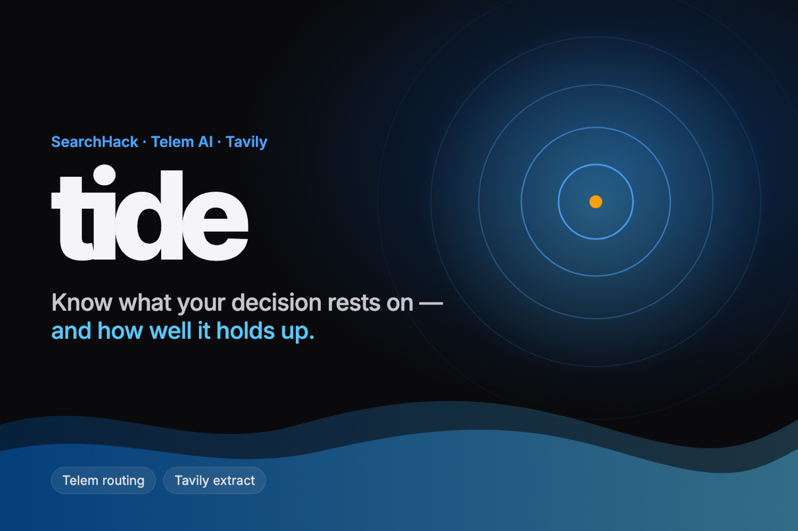
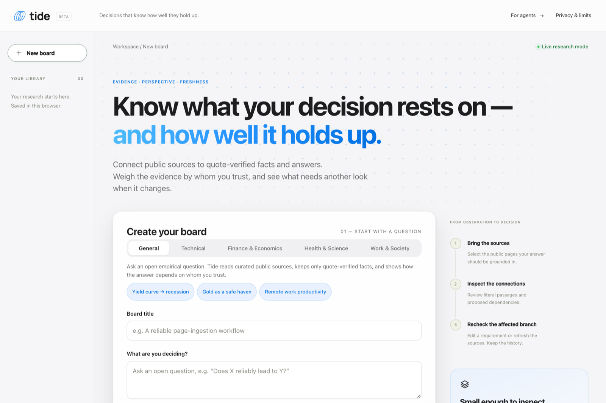
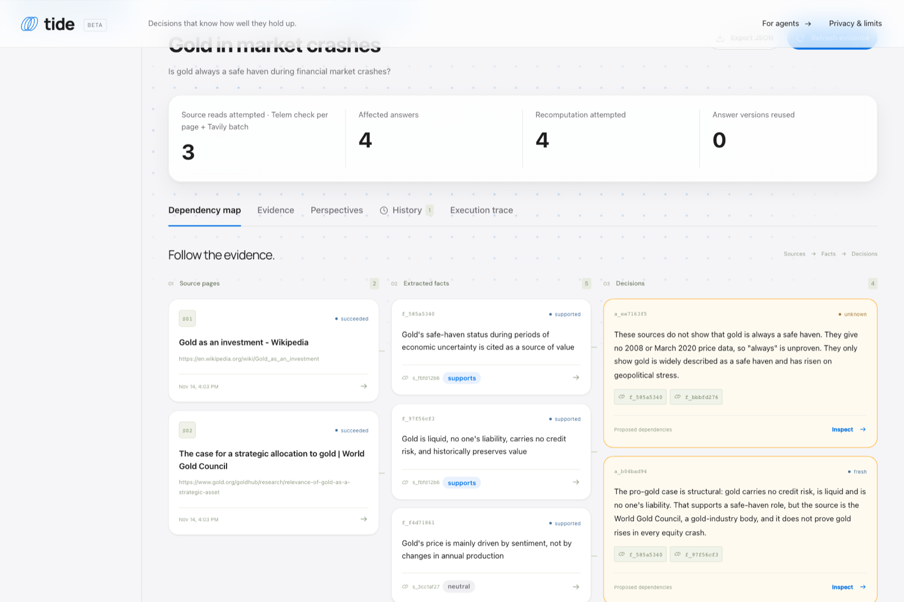
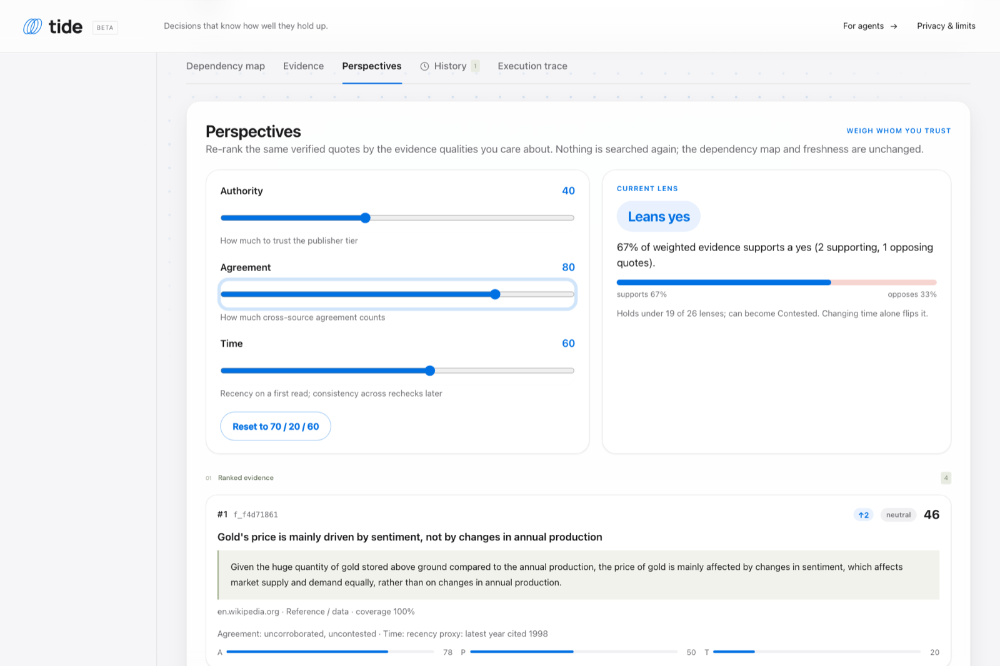
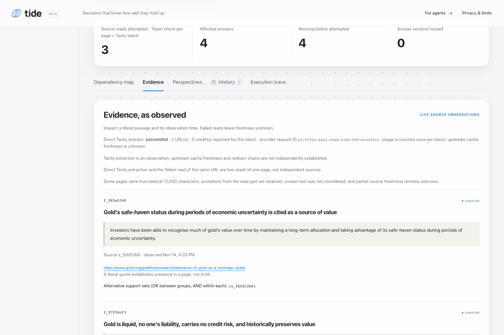
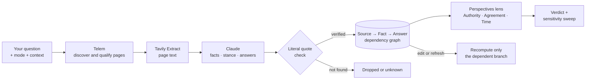
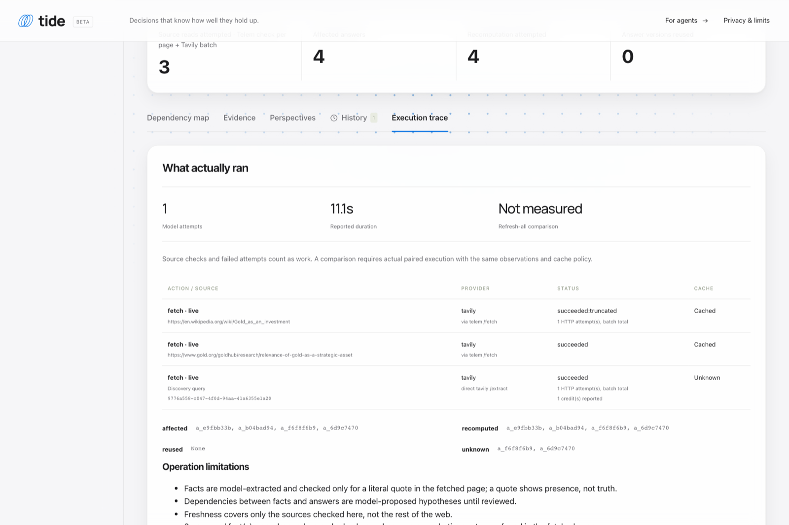

<p align="center">
  
</p>

<p align="center">
  <a href="https://tide-search.vercel.app"><b>Live demo</b></a> ·
  <a href="https://youtu.be/SI2tCBHnZGA"><b>Video</b></a> ·
  <a href="#how-it-works"><b>How it works</b></a> ·
  <a href="#run-it-locally"><b>Run locally</b></a>
</p>

<p align="center">
  
  
  
  
  
  
  
</p>

---

## Why Tide

Every research-backed decision runs into simply two questions.

> **Is this still true?** Docs, data and reports change quietly, and your notes never say which conclusion a change just broke.
>
> **Does it hold up if I trust different evidence?** The same question can lean yes or no depending on whether you weight official sources, agreement, or consistency over time.

We started with two separate ideas, one for each question. The first was an answer that remembers exactly which facts and pages it rests on, so a change rechecks only what it touches. The second was a way to see how a conclusion holds up when you change which evidence you trust. They turned out to be two halves of the same problem, so we built **Tide**.

|  | Before Tide | With Tide |
|---|---|---|
| **Provenance** | No record of which page or sentence an answer came from | Every answer links to quote-verified facts and the exact pages behind them |
| **Change** | A source changes, so you redo everything, or nothing | Only the answers a change touches are recomputed; the rest are reused |
| **Confidence** | One verdict, with no sense of how fragile it is | Drag trust weights and see whether the verdict holds, or what flips it |
| **Failure** | A missing source leaves an old answer looking current | Failed reads show as **unknown**, never falsely fresh |

## What it does

<table>
<tr>
<td width="50%"><br><b>Ask in a mode.</b> General, Technical, Finance &amp; Economics, Health &amp; Science or Work &amp; Society. Each mode reads its own curated sources.</td>
<td width="50%"><br><b>Follow the evidence.</b> Source pages lead to quote-verified facts, each with a stance, which lead to plain-language answers that cite them.</td>
</tr>
<tr>
<td width="50%"><br><b>Weigh whom you trust.</b> Authority, Agreement and Time sliders re-rank the evidence live, with a verdict and a 26-lens sensitivity check.</td>
<td width="50%"><br><b>Check every quote.</b> Literal passages, source URLs, observation times and provider request IDs.</td>
</tr>
</table>

- **Quote-verified facts.** A fact is kept only if its quote appears literally in the fetched page. Disclaimers and boilerplate are filtered out.
- **Selective recheck.** Edit your context and Tide recomputes only the dependent answers, with zero pages re-read. Refresh and only answers whose facts changed are recomputed.
- **Verdicts with nuance.** *Leans yes · Leans no · Contested · Insufficient evidence*, each with the weighted support split and which single weight would flip it.
- **Yours to keep.** Boards live in your browser (IndexedDB) with immutable revisions, plus JSON export and import. No account.
- **Agent-ready.** A local MCP kit with 9 tools and 2 skills brings the same boards to Claude Code and Codex.

## How it works



<p align="center"><br><sub>Every run shows what actually executed: Telem checks, direct Tavily extracts, request IDs and timing.</sub></p>

## Modes

| Mode | Curated sources | Try asking |
|---|---|---|
| **General** | Every curated source below except developer docs | *Does an inverted yield curve reliably predict a U.S. recession within 12 months?* |
| **Finance & Economics** | Federal Reserve, NY Fed, FRED, BLS, BEA, NBER, IMF, World Bank, OECD, BIS, ECB, Wikipedia, AP/BBC/NPR | *Is gold always a safe haven during financial market crashes?* |
| **Health & Science** | WHO, CDC, NIH, PubMed, PMC, Nature, arXiv, Our World in Data | *Does moderate coffee consumption lower the risk of type 2 diabetes?* |
| **Work & Society** | Pew, Gallup, Brookings, Stanford, NBER, BLS, OECD | *Does remote work improve employee productivity?* |
| **Technical** | MDN, Node.js, Next.js, React, Postgres, Redis, Supabase, Vercel and more | *How should I batch public page fetches?* |

Authority tiers are shown on every card: official statistics › peer-reviewed › reference › survey › news › industry body. Modes are pure data in [`src/lib/modes.ts`](src/lib/modes.ts), so adding one is a data change.

## Built with

| Layer | Tech |
|---|---|
| App | Next.js 16 · React 19 · TypeScript · Zod |
| Design | Apple HIG-inspired system type and materials · React Bits (RippleGrid, BlurText) · reduced-motion aware |
| Search and evidence | **Telem** (`hack.telem.ai`) for discovery and routing · **Tavily Extract** for page text · **Claude** for structured extraction |
| Safety | Server-signed snapshots · per-mode source allowlists · SSRF and redirect guards · atomic **Upstash Redis** quotas |
| Storage | Browser IndexedDB with immutable revisions · JSON archives |
| Agents | Local stdio MCP server ([`packages/ripple-mcp`](packages/ripple-mcp)) |

## Run it locally

```bash
git clone https://github.com/hxxtsxxh/tide.git && cd tide
npm ci
# create .env.local with the variables below
npm run dev   # http://localhost:3000
```

<details>
<summary><b>Environment variables</b></summary>

| Variable | Purpose |
|---|---|
| `TELEM_API_KEY` | Telem search and qualification (hack.telem.ai) |
| `TAVILY_API_KEY` | Direct Tavily page extraction |
| `APP_MODEL_PROVIDER`, `APP_MODEL`, `ANTHROPIC_API_KEY` | Structured extraction model (`OPENAI_API_KEY` if the provider is `openai`) |
| `UPSTASH_REDIS_REST_URL`, `UPSTASH_REDIS_REST_TOKEN` | Shared, atomic usage quotas |
| `RIPPLE_STATE_SECRET` | Signs board snapshots (32+ characters) |
| `RIPPLE_PUBLIC_BETA` | `true` to enable the public beta |
| `RIPPLE_SOURCE_HOSTS`, `TIDE_GENERAL_HOSTS` | Optional source-list overrides |
| `RIPPLE_GLOBAL_RUNS_PER_DAY`, `RIPPLE_VISITOR_RUNS_PER_DAY`, `RIPPLE_VISITOR_RUNS_PER_MINUTE` | Optional quota limits |

Some identifiers keep a `RIPPLE_` prefix for compatibility with the original engine's contracts.
</details>

```bash
npm run check      # TypeScript
npm test           # 151 tests
npm run test:mcp   # 23 MCP agent-kit tests
npm run build      # production build
```

## Project structure

```
src/
  app/                 Next.js routes, API endpoints, styles (apple.css)
  components/          Workspace, BoardInspector, Perspectives, ModePicker, React Bits
  lib/
    search/            Telem client, Tavily extract, planner, passage selection
    model/             Structured extraction and answer rewriting
    perspective/       Authority / Agreement / Time scoring, verdict, sensitivity sweep
    server/            Guarded endpoints, quotas, signed snapshots, research pipeline
    modes.ts           Research modes and authority tiers
packages/ripple-mcp/   Local MCP agent kit
tests/                 Unit and contract tests
```

## Good to know

- A verified quote proves a page said something, not that it's true. Stance and dependencies are model-proposed and shown for review.
- Boards are deliberately small (up to 5 sources, 10 facts and 6 answers), sources come from curated lists, and refresh runs only when you ask.

<p align="center"><sub>Built for <b>SearchHack</b> · powered by <b>Telem</b> and <b>Tavily</b></sub></p>
